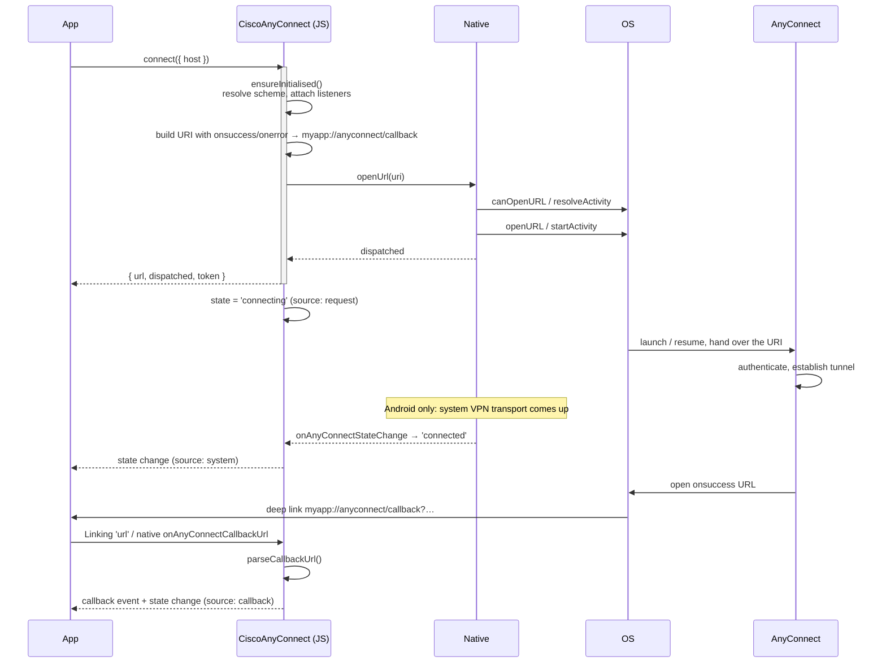

# Architecture

## The constraint that shapes everything

Cisco publishes no embeddable AnyConnect SDK. Putting the tunnel inside your own app requires the
partner SDK (NDA + paid licence) and, on iOS, Apple's `packet-tunnel-provider` entitlement. The only
public automation surface is the `anyconnect://` URI handler, which is:

- **fire-and-forget** — dispatching a URI returns nothing;
- **user-visible** — AnyConnect shows its own UI;
- **asynchronous** — the outcome arrives later, if at all.

So this package is a **controller**, not a tunnel. Everything below follows from making an
unreliable, out-of-process, asynchronous interface behave like a normal API.

## Layers

```
┌──────────────────────────────────────────────────────────────┐
│ Your app                                                     │
│   CiscoAnyConnect.connect()  ·  useAnyConnect()  ·  events   │
└───────────────────────────┬──────────────────────────────────┘
                            │
┌───────────────────────────▼──────────────────────────────────┐
│ Facade — src/CiscoAnyConnect.ts                              │
│   state machine · listener registry · callback-scheme        │
│   resolution · Linking/AppState wiring · URL interpretation  │
└───────────────────────────┬──────────────────────────────────┘
                            │  AnyConnectTransport (seam)
┌───────────────────────────▼──────────────────────────────────┐
│ Transport — src/transport.ts                                 │
│   UriHandlerTransport: builds the anyconnect:// URI          │
│   (a Cisco SDK or in-process tunnel would implement here)    │
└───────────────────────────┬──────────────────────────────────┘
                            │  native primitives
┌───────────────────────────▼──────────────────────────────────┐
│ Native module — ios/ + android/                              │
│   isInstalled · getAppInfo · canOpenUrl · openUrl            │
│   getAppUrlSchemes · getState · consumePendingCallbackUrls   │
│   + events: state change, captured callback URL, URL result  │
└───────────────────────────┬──────────────────────────────────┘
                            │
        ┌───────────────────┴───────────────────┐
        ▼                                       ▼
   OS deep-link routing                  ConnectivityManager /
   (Intent / UIViewcontroller)           UIApplication
        │                                       │
        └──────────────► Cisco Secure Client ◄───┘
```

A deliberate split runs through this: **the native layer does only what JavaScript cannot.** It
probes for the app, opens URLs, reads the app's own registered schemes, observes the system VPN
transport, and captures incoming intents. Everything protocol-shaped — URI construction, callback
URL parsing, state transitions — lives in TypeScript, where it is a pure function and is unit tested.

## The transport seam

`AnyConnectTransport` exists so the choice of integration surface is not baked into the public API.

```
AnyConnectTransport
├── id: string
├── isAvailable() / getAppInfo()
├── createConnection / connect / disconnect
├── importProfile / importCertificate / localize
├── closeGui
└── dispose?()
```

`UriHandlerTransport` is the shipped implementation. A `CiscoSdkTransport` or
`TunnelProviderTransport` implements the same interface; callers then use
`CiscoAnyConnect.setTransport(...)` and nothing else changes — including the events, since the facade
owns state regardless of which transport produced it.

The transport receives one injected dependency: a `resolveCallbackScheme()` callback. That is the
only piece of the facade it needs, which keeps it testable in isolation.

## Connect flow



Steps, in words:

1. `connect()` triggers lazy initialisation: the callback scheme is resolved, native listeners are
   attached, any callback URLs captured natively are drained, and `Linking`/`AppState` are wired.
2. The transport builds `anyconnect://connect/?…` with `onsuccess` and `onerror` percent-encoded URLs
   pointing at `<scheme>://anyconnect/callback`, carrying an opaque `token`.
3. `openUrl` hands the URI to the OS. Android uses `ACTION_VIEW` from the *current activity* so the
   app does not need `FLAG_ACTIVITY_NEW_TASK`; iOS pre-checks `canOpenURL` before `UIApplication.open`.
4. The facade optimistically moves to `connecting` (`source: 'request'`) and returns the dispatch
   result, so the caller can show feedback immediately.
5. AnyConnect connects and opens the callback URL, which routes back into your app.
6. The facade parses the URL, moves the state, and emits both a callback event and a state event.

## Callback routing

The interesting platform difference is step 5–6.

**Android** captures the URL natively. `OnNewIntent` handles a running app; the launch intent is read
in `OnCreate` for a cold start. Captured URLs are queued *and* emitted, so neither case is lost —
the queue exists because a cold-start link arrives before any JS listener exists, and is drained
during initialisation and whenever the app returns to the foreground.

**iOS** cannot hook URL delivery from inside an Expo module, so the module subscribes to React
Native's core `Linking` (not `expo-linking` — no extra dependency) and to `AppState`. That is why
`autoWireDeepLinks` exists, and why `handleCallbackUrl` is public: if your app already owns URL
handling, turn auto-wiring off and forward links yourself.

Both paths converge on `parseCallbackUrl`, which requires an exact path match and rejects
host-style URLs, so unrelated deep links are ignored rather than misreported.

## State machine

```
             connect()                 system/callback
  disconnected ────────► connecting ──────────────────► connected
       ▲                     │                              │
       │                     │ callback(error)              │
       │                     ▼                              │
       │                disconnected                        │
       │                                                    │
       │      disconnect()          callback / system       │
       └──────────────── disconnecting ◄────────────────────┘
```

Sources, and why they matter:

| `source` | Set by | Trust |
| --- | --- | --- |
| `request` | dispatching an action | Intent, not fact. |
| `system` | Android VPN transport, or `refresh()` | Observed fact. |
| `callback` | a URL from AnyConnect | Observed fact (per-connection). |
| `initial` | first snapshot | Starting value. |

Two rules keep this honest:

- **`refresh()` never lets `unknown` overwrite a known state**, so iOS keeps a callback-derived state
  instead of being reset on every foreground.
- **Foreground does not call `refresh()`** — only drains callbacks. Polling on resume would clobber
  an in-flight `connecting` with a `disconnected` reading taken before the tunnel came up.

On Android the transport observation is authoritative and available even when the user connected
from outside your app. It cannot attribute the tunnel to AnyConnect specifically; there is no public
API for that. On iOS no observation is possible, so the module reports `unknown` and `null` rather
than inventing a value.

## Why not the Android AIDL service API

Some Cisco integrations use a bound AIDL service on Android. It is not publicly documented for
general third-party use, and it requires the calling package to be allow-listed in the AnyConnect
profile. That is a partner/MDM arrangement, not something a distributed npm package can assume.
The URI handler works for everyone, so it is the default; the transport seam is where an AIDL
implementation would go if your fleet is provisioned for it.

## File map

| Path | Responsibility |
| --- | --- |
| `src/index.ts` | Public export surface. |
| `src/CiscoAnyConnect.ts` | Facade: state machine, listeners, scheme resolution, deep-link wiring. |
| `src/transport.ts` | `AnyConnectTransport` + `UriHandlerTransport`. |
| `src/uri.ts` | Pure `anyconnect://` builders and callback parser. No native dependency. |
| `src/CiscoAnyConnectModule.ts` | Native module binding; optional so imports never throw. |
| `src/CiscoAnyConnectModule.web.ts` | Web stub (unsupported, degrades cleanly). |
| `src/CiscoAnyConnectError.ts` | Error class with stable codes. |
| `src/CiscoAnyConnect.types.ts` | All public types. |
| `src/useAnyConnect.ts` | React hooks. |
| `ios/AnyConnectDetector.swift` | Availability, scheme discovery, URL dispatch (UIKit only). |
| `ios/CiscoAnyConnectModule.swift` | Expo module definition. |
| `android/…/AnyConnectDetector.kt` | Availability, package metadata, scheme discovery, dispatch. |
| `android/…/VpnStateObserver.kt` | System VPN transport observation. |
| `android/…/CiscoAnyConnectModule.kt` | Expo module definition + callback URL capture. |
| `plugin/src/index.ts` | Config plugin writing Info.plist / AndroidManifest. |

## Testing strategy

The architecture is arranged so the risky logic is testable without a device:

| Layer | How it is verified |
| --- | --- |
| `uri.ts` | Unit tests pinning Cisco's exact wire format, including encoding quirks. |
| Facade | Unit tests against a missing native module — the Expo Go / web path, plus state transitions and event emission. |
| Config plugin | Run through Expo's real mod chain; the resulting `Info.plist` and `AndroidManifest` are asserted. |
| Native | `swiftc -parse` for syntax; behaviour is exercised through the example app. |

See [DEVELOPMENT.md](../DEVELOPMENT.md) for commands.
